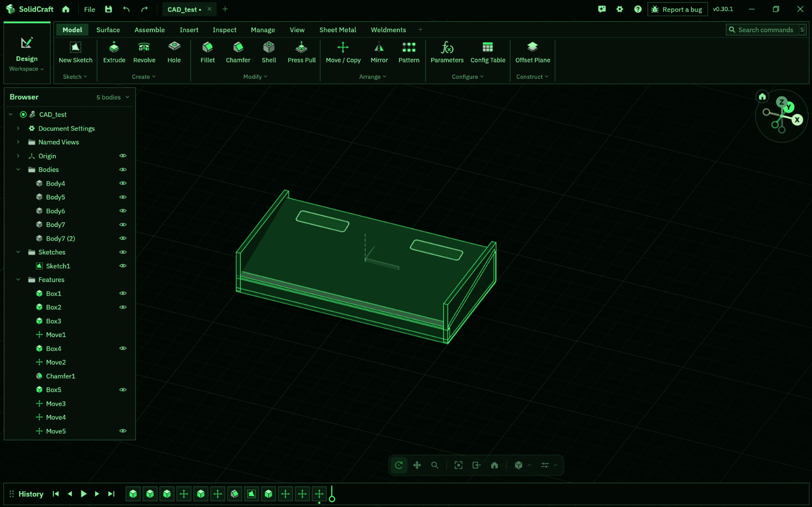
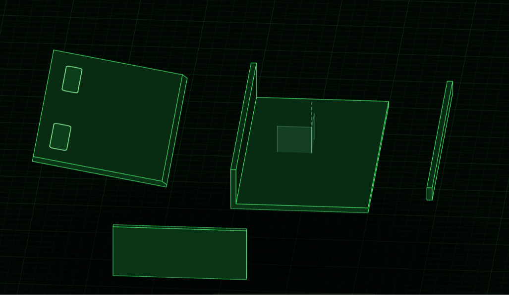

# Spatial Air-Mouse & Gesture Trackpad

## What it is & How to use it
The Spatial Air-Mouse is a compact, wedge-shaped desktop input device designed to track motion and hand gestures in 3D space. 

* **How to use it:** Rest your palm on the 10–15° sloped wedge enclosure. Wave your hand or fingers over the integrated APDS9960 gesture sensor to trigger macros or commands, while the MPU6050 accelerometer tracks physical spatial movement. Real-time status feedback and system states are displayed instantly on the built-in OLED screen.

## Why I made it
Since watching *The Avengers* (2012) as a kid, I’ve dreamed of building real-world versions of the futuristic movie tech seen in MCU and sci-fi films. For my first project in Hack Club Fallen, I chose to bring this vision to life by combining custom 3D parametric CAD modeling with an accessible, direct-build hardware approach using a Raspberry Pi Pico.

## Hardware & CAD Design
* **Enclosure:** Modeled using lightweight, open-source local CAD software (SolidCraft) running on an integrated-GPU laptop, featuring a 2.0 mm wall thickness and optimized internal clearances.

* **Electronics Assembly:** Direct-to-perfboard/breadboard soldered architecture prioritizing reliability and durability.